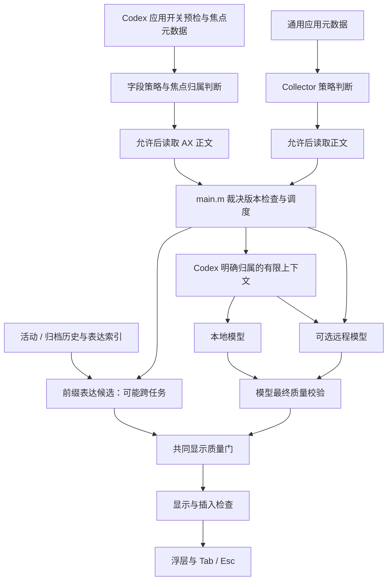

# 当前架构与整理边界

面向维护者。核心续写与候选路径已核对至本次 [C1 工作包](validation/2026-09-08-c1-candidate-lifecycle.md)；以下为源码现状，已随 `49cff39` [体验版](validation/2026-09-08-morning-experience.md)安装，未做全仓重审。目标模块见 [产品化计划](plans/2026-09-08-product-consolidation-plan.md)，尚未按该结构完成拆分。[产品契约](product.md) 是要求，不能自动当作现有实现保证。新的目标契约见[核心体验设计](plans/2026-09-08-core-completion-design.md)，不覆盖下文现状。

## 现有目录与来源

| 区域 | 实际职责与边界 |
| --- | --- |
| `Sources/CodexPromptAssistantPOC` | `main.m` 装配 AppKit、菜单、AX、策略、上下文、定时器、代次、候选和插入 |
| `Sources/RemoteCompletionCore` | 两个客户端实例分别处理本地/远程传输；提示构造和输出过滤仍与协议混合 |
| `Sources/CodexDataCore` | 扫描本地 Codex 活动/归档历史、加密存储、导入、增量更新；不是实时上下文提供者 |
| `Sources/ExpressionLibraryCore` | 从已建立的历史表达索引按当前前缀匹配，不接收当前应用或任务身份 |
| `Sources/ChatGPTImportCore` | 离线导出文件导入；不读取当前 ChatGPT 页面 |
| `Integrations/WPS` | 实验加载项和文件桥接；宿主验收未完成 |
| `Tests` / `Tools` | 独立测试程序、探针和基准；离线不等于所有本机资源均隔离 |

## 真实路径与已有差距

1. **Codex AX 读前门禁已在源码收敛，运行验收未完成。** [通用 Collector](../Sources/CodexPromptAssistantPOC/SafeInputContextCollector.m) 保留先判策略再读正文；[AccessibilityService](../Sources/CodexPromptAssistantPOC/AccessibilityService.m) 现在先检查应用/暂停、当前焦点归属及字段语义，再读 AXValue，长元数据扫描后再次检查。底部回退只定位元数据，未知焦点不凭旧控件授权。启动和手动恢复均注入同一协调器。[main](../Sources/CodexPromptAssistantPOC/main.m) 保留字段裁决，拒绝过期规则/暂停代次，并清除旧正文、标题与可用快照，关闭时禁止影子输入恢复候选。计数桩证明的范围和宿主 AX 非原子边界见 [B-02 验收](validation/2026-09-08-codex-read-policy.md)；上一轮安装的 `21733bb` 已包含修复，实机范围见 status。
2. **当前输入与历史表达是不同来源。** `configureDataFoundation` 为所有自动候选接入同一表达 lookup；[索引](../Sources/ExpressionLibraryCore/ExpressionSuggestionIndex.m) 只接收输入/光标/选区。普通应用不额外读取自身聊天历史、模型不附 Codex 对话，但表达命中仍可来自跨任务本地历史。
3. **源码已增加共同显示质量门。** 两个模型客户端保留 `requiresFinalValidation`；表达、缓存重定位及模型候选显示前经过同一协议的重复、回应与布局校验，并核对光标边界。C1 先形成提案，检查后才提交 Coordinator/显示身份；后到拒绝不清掉仍有效旧候选，原绑定失效仍须撤销。检查以确定性规则为主，语义等价和范围偏离仍未闭合，见 [质量记录](validation/2026-09-08-continuation-quality.md)。`PromptDraftCompleter` 有实现和测试，当前生产 lookup 未接入它；手动“测试灰字”是独立演示入口，不是自动候选。
4. **模型生命周期只完成局部隔离。** `e1b4154` 移除 `applicationWillTerminate` 的模型 `stop`；本地补全开启时配置客户端仍调用 `ensureRunning`，服务不存在时可能 bootstrap。关闭本地不退出常驻模型。旧版本退出路径仍可能 stop；本次限定更新通过三进程连续性验收，一般部署/回滚边界见 [release](release.md)。
5. **本地与远程独立选择。** 设置持久化两路暂停位；关闭本地同时跳过模型请求、预热与历史表达自动候选，关闭远程阻止调度、密钥准备后的发出。两路均关时停止自动轮询补全；切换撤销任务/候选并重新观察当前草稿。两路独立计时，远程不再等待本地结束。双开且当前策略允许远程时，本地客户端只提供可验证的字面范围/选项补齐，跳过模型、模型缓存和发现；开放语义续写由远程作者模板生成。仅本地模式保留原本地模板和生成路径，此路径的通用原意保持缺口仍在。两路设置不因分工改变；远程超时不自动回退至未经验证的本地语义扩写。C1 首个过门候选显示后固定，后到结果不替换，已显示时不再启动增强请求。远程仍受原应用/站点授权限制。

6. **C1 已修复候选提交顺序，未实机验收。** 原远程完成先写候选再过共同门的风险已由合成生产入口复现；当前由唯一显示入口先核对完整输入/策略/Context 依赖，再写待插入文本和显示身份。两个模型只接受最终结果，禁止预览抢占稳定候选。迟到、Esc/Tab 竞争、焦点恢复及不同 Context 依赖均有[离线回放](validation/2026-09-08-c1-candidate-lifecycle.md)；不把这些结果当作实机验收或语义质量保证。

## 当前状态所有权

| 所有者 | 当前持有的状态 | M1 拆分时必须保留的边界 |
| --- | --- | --- |
| `CPAAppDelegate / main.m` | 前台缓存、菜单策略、定时器、请求引用、输入/显示状态、会话及 preparation 代次 | 主要调度与 UI 更新在主线程；菜单抽取后不能成为第二个调度器 |
| `AccessibilitySnapshotBroker` / Generic AX worker | AX 读取、探测代次、结果发布 | 过时读取可能继续，但过时结果不发布；Snapshot 属性当前可写，不是类型保证不可变 |
| `ConversationContextProvider` | ID/来源（兼容标题入口）、选择代次、不可变消息快照和内容修订、刷新 | 一次读取修订及对应材料；实际选入内容变化推进版本，同内容重复发布不推进 |
| 两个 `RemoteCompletionClient` | 各自活动任务、取消/完成、缓存、熔断与错误 | 客户端完成不等于 UI 仍可插入；当前输入/任务有效性在主入口再判 |
| `LocalSuggestionCoordinator` | 待插入文本与完整正文、选区、归属和代次的临时 HMAC 签名 | 是候选容器和 lookup 包装，尚不是完整 Runtime |
| `DataFoundationController` / 表达索引 | 扫描、解密、内存索引与前缀匹配 | 与实时 Context 分开；不把命中当作当前任务事实 |
| `OverlayController` / `KeyboardInterceptor` | 展示、按键、影子输入、实际插入 | 不自动发送；显示与插入分阶段验收，保留原有输入法和焦点保护 |

`cancelPendingSuggestionForReason:` 等取消方法并不会自动完成所有 Coordinator/浮层清理；禁用路径在主入口另行清理。不能在提取时把看似重复的清理删除。当前安全性依赖边界取消、正文比较、代次和插入签名组合；C1 额外绑定实际策略结果/访问模式，以及请求实际提供的历史快照，显示和新鲜接受时复验。[B-04 第一包](validation/2026-09-08-candidate-ownership.md) 已将长度签名替换为包含完整正文、选区、应用/PID、控件 token、主机、规则及任务/暂停代次的临时 HMAC。Codex 和通用 AX 使用同一身份辅助类，将控件及其窗口的 CFEqual 身份与 renderer 标识绑定到不持久化的 token；数值 windowIdentifier 仍为 0，窗口范围通过 fieldIdentity 表达。WPS 保留原 documentId 桥接路径。[B-04 第二包](validation/2026-09-08-fresh-acceptance.md) 的 Tab 接受不再复用缓存、影子输入或旧锚点：在对应串行 AX 队列新读取，主线程核对票据、规则、上下文及完整签名，再向指定 PID 投递。等待期间的输入/切换/暂停/取消与一秒截止撤销接受。最后校验和宿主消费仍非原子操作，不能据此宣称所有窗口/任务竞态已解决。

## 上下文、错误与性能语义

[ConversationContextProvider](../Sources/CodexPromptAssistantPOC/ConversationContextProvider.m) 生产 Codex 路径先由 CodexThreadIDResolver 取得当前任务 ID，再按本地状态库查询并核对日志首行；兼容标题入口仅供旧调用。自动 ID 的实机阻断和剪贴板边界见 [接入验收](validation/2026-09-09-codex-id-integration.md)。C1 的 currentSnapshot 一次提供 selectionGeneration、revision、messages、sourceURL、截断信息和 Missing / Loading / ReadyEmpty / Ready / Ambiguous / Error。旧 contextState 保留 Empty / Loading / Ready 兼容含义，不能据其 Ready 推断非空或无错误；旧 contextGeneration 现在返回内容修订，生产请求改用整份快照。文件属性从文件系统新读，避免 NSURL 缓存漏更新；同内容/角色/来源/截断信息不变时不增版本。

当前历史预算：最近最多 6 条用户消息、2 条最终回复，单条 400/300、合计 3000 个 NSString 长度单位（UTF-16；不等同 token），长消息保留首尾并照顾组合字符边界；最多读取日志末尾 8 MiB。只返回实际找到且通过过滤的消息，不保证满额，更不是全历史。

[客户端](../Sources/RemoteCompletionCore/RemoteCompletionClient.h) 分别返回成功候选、成功但无候选、取消或错误。`Success + nil` 不等于传输失败；不应为所有空结果无条件重试。C1 已增加内容修订和 Context 可用性；原始生成/过滤/显示的统一评测记录、语义拒绝分类仍留 C2，不能从结构状态推出模型理解正确。

本地请求/资源超时当前 10/12 秒，远程 5/6 秒；这些是请求上限，不是用户等待 SLA。历史中的约 2.9 秒/7 秒样例和离线数据 P95 不能相互替代，也不能推出整体模型性能。后续测量分开记录冷/热、上下文规模、取消、无候选与有效展示耗时。

## M1 必须先固定的回放与缺口

至少覆盖输入变化→迟到结果、同长度替换、切换任务/窗口、菜单关闭、组合输入、Tab 回显→下一次调度、短暂失焦→恢复。每例都注明取消/清理/发布/接受由谁负责，先保留旧测试，建立替代覆盖后再迁移入口。

本轮确定的操作阻断和优先处理项统一在 [状态页](status.md) 维护；不把上述目标写成已实现接口。历史决策及替代链见 [ADR 索引](adr/README.md)。

## WorkBuddy 上下文扩展（已安装，待实机验收）

[9/9 接入记录](validation/2026-09-09-workbuddy-context.md)在普通输入采集后增加专用 WorkBuddy AX 子树读取器，材料仅内存传递至两路模型与插入签名。11:47 用户授权后已安装，WorkBuddy 是“普通应用仅当前输入”的专门例外，其他应用保持原行为。非空宿主 AX 与实机验收尚未完成。
