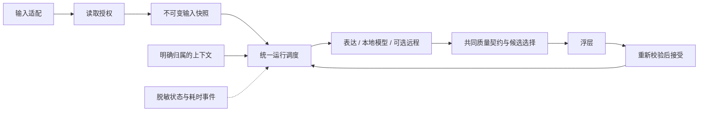

# Codex 智能提示助手：项目梳理与产品化规划

日期：2026-09-08。初稿调研基线 `862b81d`；M0 工程交付基线 `d5c79dc`。本计划维护路线、门禁与职责，不维护另一份当前支持矩阵。M0 圆桌后状态以 [status](../status.md) 为准，M1–M5 尚未完成。

**用户已确认的优先级：便于长期维护和迭代的完整产品。**

初稿交付为项目地图和整理规划。2026-09-08 用户随后授权继续 M0 并注意 Git 版本管理：按工作包独立提交，不推送，不安装或重载应用。当前执行状态见 [状态页](../status.md)。近期实机结果引用既有验收记录，不冒充本轮重新测试。

## 1. 产品定位与边界

用户已确认长期维护与迭代优先。已明确的续写、无解释、无猜测、保持语境和无发送要求统一落在 [产品契约](../product.md)。这里不再次复制参数、支持矩阵或“已完成”声明。

维持本地处理为主、可选远程、渐进整理现有实现的方向。跨任务表达、当前任务实时上下文与当前输入是不同来源，不能笼统写成“理解全部聊天”。分发、名称、模型分发方式及首次等待目标仍待后续产品决策。

## 2. 调研快照与项目地图

初稿 `862b81d` 时有 201 个 Git 跟踪文件，Sources 约 17,598 行、Tests 约 6,896 行，main.m 3098 行、HANDOFF 1371 行；这些是历史定位数据，不是持续维护的规模指标。生成目录已经忽略，不作为待清理业务代码。

当前目录、真实调用路径、来源与状态所有权统一见 [架构](../architecture.md)。原调研的统一“策略→正文→最终质量门”概括过强：Codex 与通用输入的读前门禁不同，表达候选不走模型质量门；圆桌已在架构中纠正。目标数据流保留在第六节，不能当成已经完成的目录或接口。

## 3. 能力与证据

以 [当前状态](../status.md) 的应用/控件/操作/证据表为唯一现状入口。历史试验不自动适用于当前构建；宿主版本未记录时不得推算。上下文预算、Ready 的空值语义、模型请求与性能样例的区别见架构。

M0 原验收记录保留当时实际通过结果，本轮 [圆桌补充](../validation/2026-09-08-m0-roundtable.md) 记录静态缺口、确切包身份及未验证动作，不把先前通过改写为失败，也不据此掩盖新发现。

## 4. 问题分层与顺序

- 工程基础：单一现状入口、可追踪构建、分层验证和操作副作用，M0 先厘清；具体未闭合项按状态页 B-01–B-07 跟踪。
- 近端边界：模型生命周期与助手更新耦合、Codex 读前策略、测试共享资源；先绑定到相关操作的门禁，不能整体推迟为设置界面优化。
- 可维护性：main.m 的状态所有权与接口，M1 渐进抽取，保留原保护和测试直到替代覆盖建立。
- 内容与体验：共同质量契约、可解释上下文、语义评测、来源和延迟，M2/M3；应用适配与 WPS 宿主 M4。
- 产品化：安装、回滚、签名/分发与版本节奏，按 M3/M5 完成，不以整理目录替代这些结果。

## 5. 整理方案选择

| 方案 | 收益 | 代价与风险 | 结论 |
| --- | --- | --- | --- |
| 渐进划分职责、保留现有技术栈 | 每步可运行、可比较、可回退，利用现有测试和实机经验 | 需要明确迁移顺序，过渡期保留薄适配层 | 推荐 |
| 先只整理目录和文档 | 立刻改善查找和交接 | 状态耦合与验证不足仍在 | 作为第一步，不作为全部工作 |
| 全量改写为新框架/新应用 | 可以重新组织全部结构 | AX/输入法/签名/插入行为需大量重验，容易长时间失去可用版本 | 暂不采用 |

不急于更换 Objective-C、AppKit、Makefile 或本地模型。技术栈调整必须有具体收益和独立验证，不能用来代替职责梳理。

## 6. 目标模块与职责

下面是建议目标，不是当前目录已经完成的状态。初期使用同一 App 内的源文件分组，不立即拆成多个 framework、进程或动态插件系统。

| 目标模块 | 复用/迁入的现有能力 | 单一职责与对外结果 |
| --- | --- | --- |
| App | main、菜单、设置、启动/退出 | 装配服务、展示状态；不直接拼提示词或管理请求竞态 |
| Runtime | 调度、焦点恢复、输入变化、取消、接受后触发 | 管理一次建议生命周期；拥有唯一的请求/候选状态 |
| InputAdapters | Codex AX、Generic AX、场景识别、WPS adapter | 在策略允许后产出输入快照；声明支持的读取与插入能力 |
| Policy | SafeInputContextCollector、SuggestionPolicy 系列 | 决定读什么、是否允许生成/远程/插入；统一原因码 |
| Context | 任务识别、ConversationContextProvider | 明确来源、版本、消息选择、字符预算和降级原因 |
| Completion | 共用传输、Local/Remote provider、表达检索 provider | 输入同一请求对象，输出候选或明确的无候选结果 |
| Quality | 后缀校验、重复/回应/事实约束、候选选择 | 对不同来源执行共同契约，区分确定性规则与语义评测 |
| Presentation | OverlayController、键盘接受/取消接口 | 只显示有效候选，插入前再次核对焦点与版本，不抢焦点 |
| Storage / Integrations / Diagnostics | 现有数据核心、导入、WPS、日志与服务控制 | 离线数据生命周期、实验集成、无正文诊断与部署支持 |

### 需要先明确的三个数据对象

- **InputSnapshot**：复用 `CPAAccessibilitySnapshot`，逐步收敛应用、窗口、控件、光标、输入版本及允许的访问范围；快照不可变。
- **ContextSnapshot**：消息、任务身份、generation、字符数、状态、原因码。区分“任务尚未识别 / 唯一匹配失败 / 历史为空 / 正在加载 / 可用”。这些原因留在诊断中，不当作提示词正文。
- **SuggestionRequest / Candidate**：关联应用、窗口、控件、任务、策略版本和输入摘要；记录 provider、模型与提示词版本。任何一个边界变化都使旧候选不可插入。

继续复用已有 `SuggestionContextIdentity`、SnapshotBroker 和策略返回值，先补接口，逐项转移所有权。不要并行创造第二套 generation/cancel 逻辑。

### 目标数据流



所有异步工作只提交带身份与版本的结果。UI 主线程不做文件扫描、模型调用或密钥读取。传输可以流式接收，但是否展示部分结果由质量策略决定；现有模型候选的最终校验后展示行为保持；表达候选的共同质量门是目标工作，当前尚未统一。

## 7. 文档与目录如何收敛

当前文档职责如下。入口与部分文档已建立；此表定义职责，完成状态只在 status 维护：

```text
README.md                    产品说明、安装/使用、验证入口
AGENTS.md                    本项目的稳定开发约束与实际命令
HANDOFF.md                   只保留当前基线、未完成项和继续入口
docs/
  product.md                 产品契约、语义示例与非目标（要求）
  architecture.md            模块、数据流、状态所有权、边界
  status.md                  当前版本、能力矩阵、证据与待验证项
  development.md             环境、构建、测试、依赖、故障诊断
  release.md                 身份、Git、部署阻断与回滚条件（操作）
  adr/                       有效决策与 superseded 关系
  plans/                     仍在执行的计划
  validation/                按对象/日期保存证据与模板（记录）
  archive/                   旧阶段计划、历史交接和历史复盘
```

迁移规则：保留旧内容与 Git 历史；修改引用或保留跳转说明；一项事实只有一个当前维护入口。HANDOFF 不再追加整段已过期的“下一步”或授权状态。

ADR 的有效部分与替代链维护在 [ADR 索引](../adr/README.md)；旧原文保留并加状态补记。验收记录追加复核对象，不改写旧记录的执行事实。正式依据冲突时先查当时对象/日期，当前执行查 status，产品要求查 product，实现查 architecture。

## 8. 分阶段路线与完成标准

<a id="m0-gates"></a>

### M0：建立唯一基线和验证入口

**目标：任何维护者都能知道当前版本是什么、如何验证、哪些尚不支持。**

- 建立 README、项目 AGENTS、status、architecture 初稿；把旧 HANDOFF 迁为历史记录并保持链接。
- 在 Makefile 增加统一离线检查目标，汇总现有核心测试；模型基准、实机操作和安装目标保持独立，不让单元测试重载应用。
- 将版本、Git SHA、提示词版本、模型标识写入构建元数据和诊断；保留现有 bundle ID、签名 designated requirement、数据路径、LaunchAgent label，避免权限与数据迁移干扰。
- 固定一套可复用的无发送测试夹具，把 `/tmp` 实测工具中经过验证的最小部分收进 Tests/Fixtures 或 Tools。输入前后都验证草稿归属，不保存真实用户文本。

**完成标准：**从一个文档入口可找到运行模式/支持矩阵/测试命令；统一离线检查能报告实际覆盖项；构建、安装、运行的 SHA 可对应；不改变候选行为。

将原完成标准拆成以下可核对条目，不降低标准，也不将“暂未安装”直接改成通过：

| 门禁 | 必需证据 | 不足以替代它的证据 |
| --- | --- | --- |
| M0-D1 文档入口与事实边界 | 链接/锚点、契约/实现分离、历史保留、评审问题落入归属表 | 文件已创建、评审者一致同意但无源码核对 |
| M0-D2 验证入口 | 实际套件结果、网络边界、本机写入/清理限制 | `make test` 一项通过或“离线=完全隔离” |
| M0-D3 构建身份 | clean Git、包/嵌入身份一致、严格签名 | 只有版本号、提交前 dirty 包 |
| M0-D4 无发送夹具 | 独立规则分支、阳性对照、读取/显示/插入层分开、恢复归属步骤 | 静态夹具被计作实机通过 |
| M0-R1 运行身份闭环 | 指定安装包与当前运行 PID/启动日志身份匹配，三进程边界受控 | 磁盘哈希、旧安装推定 Git、构建命令成功 |
| M0-R2 最小运行回归 | Codex/TextEdit 对应控件的无发送显示/接受/取消，开关恢复，空输入与保护证据 | 历史其他版本通过、纯协议测试 |

M0 总体退出需上述条目闭合，或由用户另行明确调整范围；本轮不通过重新命名门禁把缺项视为通过。各条当前结果和阻断只在 status 维护。语义精准性全面达标、WPS 或分发不是新加的 M0 退出条件。


### M1：从 main.m 提取运行状态与界面装配

**前置：M0。当前仅允许只读定位、接口草拟与回放设计准备；若以后提前实施局部拆分，应单独明确所依赖的已闭合验证和禁止部署边界，不由本轮文档自动放行。**

- 先提取菜单/设置控制器，再提取 SuggestionRuntime；保留原 public 行为。
- 将定时器、generation、取消原因、正在生成与已显示候选的所有权转移到 Runtime；main 只持有服务和生命周期入口。
- 菜单集成测试从直接 `#include main.m` 逐步转向控制器接口，原测试保留到替代覆盖建立。
- 增加事件序列回放：输入→取消→迟到回包、菜单关闭、组合输入、窗口切换、Tab 回显→下一次生成、短暂失焦→恢复。

**完成标准：**每个状态有唯一所有者；迟到候选不显示/不插入；现有交互矩阵不退化；可以独立测试 Runtime，不依赖启动完整 app。

### M2：把上下文和生成质量变成可管理的能力

**前置：M1；评测夹具可在 M0 开始积累。**

核心体验按[独立设计 C0–C4](2026-09-08-core-completion-design.md)推进有界工作包：圆桌与文档之后，C1 已完成 Context 内容修订、候选事务和事件回放，见[C1 验收](../validation/2026-09-08-c1-candidate-lifecycle.md)；[C2 / G1](../validation/2026-09-08-c2-g1-experiment.md) 已完成公开开发对照但未通过，保留生产基线，后续按具体缺口继续单变量实验。此局部修复路径不等于开展完整 M1/M2，不改变 M0 原门禁；模型审核先离线衡量收益，未默认加入运行链路。判分、公开种子和未见集规则见[评测规范](../evaluation/core-continuation-v1.md)。

- 输出 ContextSnapshot 的具体降级原因；补两项不同任务、同名活动/归档任务、浮窗与主窗口并存的实机测试。
- 将提示词模板与版本从传输实现中分离。保留当前正确的原文预填方式，provider 明确声明模型/模板兼容范围；不同模型不直接复用未知特殊 token。
- 共用请求/取消/缓存协议，但明确 LocalModelProvider、RemoteProvider、ExpressionProvider 的边界；RemoteCompletionCore 更名放在引用迁移完成后。
- 建立包含“原文＋上下文＋禁止项＋可接受续写/不出候选”的固定评测集。至少覆盖真实复发类别：客服回应、重复、无依据事实、违背否定约束、误读问题、空输入、半词衔接、信息不足。
- 先记录分层耗时和命中收益，再决定是否调整上下文预算、预热、缓存或模型；不同时改变提示词、模型与触发时机来做一次无法归因的对比。

**完成标准：**每个候选可追溯到输入版本、上下文数量、provider 和提示词版本；每次质量调整都有同集对比；错误输出减少时同时报告候选覆盖率，防止靠全部拒绝“提高准确率”。

### M3：完善产品使用和维护流程

**前置：M1；与 M2 的评测完善部分可交错。**

- 状态栏保留高频开关；设置界面集中管理应用/站点策略、模型状态、数据扫描、暂停与恢复。
- 提供清晰的未提示原因：权限不足、当前输入不支持、历史未识别、正在生成、没有合适候选；详细技术状态放诊断页，不挤入输入浮层。
- 设计首次运行检查：权限、模型服务、当前支持范围和无发送练习框；依赖下载大小、磁盘与模型许可在决定分发方式后核对，不在本规划虚构。
- 从实际用户目录生成服务配置，加入模型版本/依赖清单、端口占用检查、只更新助手的部署与回滚流程。
- 版本更新验证 app/模型职责分离；卸载只处理本应用所有的项目，历史数据和模型删除需要独立选择。

**完成标准：**新安装与助手升级有可复现步骤；模型不可用不会卡 UI 或产生请求风暴；能判断自己正在使用的版本并回到上一版助手。

### M4：按适配器维护应用兼容性

**前置：M1/M3 的接口和诊断具备。**

- Codex / TextEdit 作为每次发布必测基础矩阵；飞书与 WorkBuddy 按实际支持的输入场景补富文本、组合输入和切换测试。
- WPS 独立实验开关及加载诊断；先验宿主加载，再验正文读取、插入、取消与异常文件清理，通过后才升级支持状态。
- 浏览器仍按精确站点策略和控件能力验收；不以放开敏感判断换取兼容率。
- 将每个适配器的身份获取、正文能力、选区映射、插入能力与限制记录在同一支持矩阵中。

**完成标准：**一个应用的一次兼容修改可以在自己的夹具中验证；不在 main.m 增加散落的应用特例；支持状态带版本、场景和证据日期。

### M5：形成稳定版本节奏

**前置：M0–M3；M4 只发布已达标适配器。**

- 每个发布有明确功能范围、已知限制、模型/提示词版本、构建 SHA、测试和实机证据。
- 常规变更优先运行关联模块测试；发布前运行完整离线检查、指定模型评测和实机矩阵，避免每个小改动都重复全套重载。
- 故障记录至少包含复现步骤、边界身份、无正文原因码和耗时；反馈进入评测集或事件回放，再进入修复队列。
- 对 WPS、远程、历史导入等独立能力分别决定保留、完善或暂缓，不把未验收部分计入稳定版承诺。

**完成标准：**可以持续做小版本迭代，每次明确增加了什么、验证了什么、哪些没有验证；不再依赖长对话恢复项目状态。

## 9. 验收与指标

以下均为建议建立的指标，不是当前已经达到的结果。

| 维度 | 测量方式 | 门槛/决策方法 |
| --- | --- | --- |
| 输入安全与隔离 | 无发送夹具验证禁止正文读取、过期候选插入、远程暂停泄漏 | 固定回归集要求零失败；不外推所有控件安全 |
| 质量 | 人工标注可插入率、回应式输出率、重复率、约束冲突率 | 同一输入/上下文/模型配置对比；同时看拒绝率和覆盖率 |
| 上下文 | 应识别场景的识别成功率、空结果原因、取样完整性、跨任务错误 | 先建立基础矩阵；跨任务串入作为发布阻断项 |
| 体验 | Tab 成功率、Esc 即时撤销、接受后续写、失焦恢复、组合输入 | 每个标为稳定的应用场景必须实测通过 |
| 性能 | 输入稳定→生成启动→首段→最终有效候选；CPU/RSS、取消量 | 冷/热、无/短/长上下文分开报告 P50/P95；M0 后设预算，不拿单个缓存样例承诺亚秒 |
| 可维护性 | 状态所有权、模块测试独立性、文档链接、发布复现 | 能按模块定位修改；不以文件数量或行数变化替代验收 |

## 10. 已交付工作包与继续入口

M0 原三包已经交付：文档与历史归档 `b805114`、离线入口与夹具 `02c8b0e`、构建身份 `d5c79dc`。这描述提交内容，不表示所有运行门禁已通过。圆桌本轮校订文档，没有改候选行为或执行部署。

继续前读取 [status](../status.md) 的门禁、B-01–B-07 和动作限制，按具体风险安排最小修复与证据；不在一包内混做菜单提取、提示词调整、模型替换与应用扩展。每包都要可独立审查/回退，保留原修改与基线。

未决产品项集中在 product.md；它们不阻碍只读整理，也不构成收费、发布、云端服务或自动下载授权。

## 11. 依据与本轮检查范围

以下行号保留为初稿 `862b81d` 的定位线索，后续文件行号会变化；当前方法及边界以 architecture 和圆桌记录为准：

- `Sources/CodexPromptAssistantPOC/main.m:1034`：数据与表达检索装配；`:1918`：表达候选及模型调度；`:2102`：本地请求；`:2929`：Tab 接受。
- `Sources/CodexPromptAssistantPOC/AccessibilityService.m:1039`：窗口级任务识别；`ConversationContextProvider.m:5`、`:355`：历史预算与消息读取。
- `Sources/RemoteCompletionCore/RemoteCompletionClient.m:235`：传输及超时；`RemoteCompletionProtocol.m:119`：请求/提示构建。
- `Sources/CodexPromptAssistantPOC/SafeInputContextCollector.h:56`：授权后正文读取；`DataFoundationController.h:48`：历史数据入口。
- `Sources/CodexPromptAssistantPOC/PromptDraftCompleter.m:32`：保留的模板实现；当前生产 lookup 见 `main.m:1059`，不能把模板存在当作启用证据。
- `Tests/CodexPromptAssistantPOCTests/ApplicationPolicyMenuIntegrationTests.m:5`：测试直接包含 main.m；`Makefile:35`、`:193`、`:270`：分散的测试目标。
- `Tools/CompletionQualityBenchmark/main.m:23`：当前固定 13 条样例，传入空历史，以输出/计时为主，未形成完整语义评分。
- `Resources/Info.plist:19`：固定产品版本；`Resources/local.codex.prompt-assistant-model.plist:9`：机器相关模型路径。

既有验收记录：

- `docs/plans/2026-09-08-conversation-context-validation.md`
- `docs/plans/2026-09-07-local-prefix-completion-validation.md`
- `docs/plans/2026-09-07-prompt-role-lark-wps-validation.md`
- `docs/plans/2026-09-07-performance-app-compatibility-validation.md`

初稿只核对实现与历史资料。后续 M0 工程测试见原验收记录；本轮圆桌范围与实际检查见新记录。不得将任一轮的范围扩写为今日全量实测通过。
