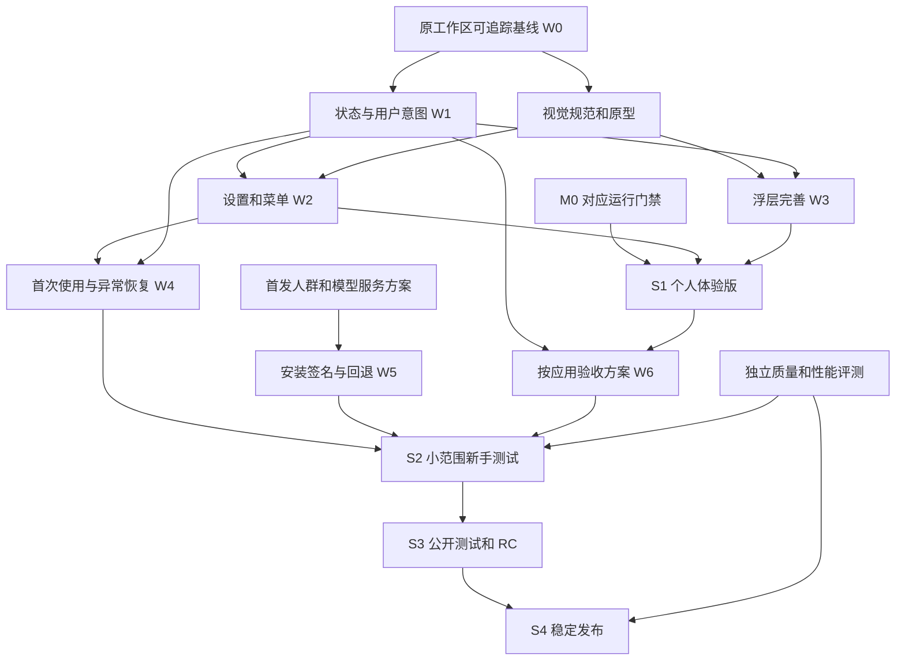

# 提示助手 UI、设置、新手交互与发布规划

日期：2026-09-14。初稿为核查与建议；当前执行状态以 [status](../status.md) 和各验收记录为准。

**2026-09-15 完整核查表：**[UI、交互与发布核查表](2026-09-15-ui-release-checklist.md)已逐项填写当前结论、剩余动作、完成条件及依据，覆盖31项核查、11项设置判断、14条流程、5个阶段和12项依赖。以下初稿用于保留设计依据；其中“五页设置”“尚无新手练习”“下一包先做原型”不再代表当前待办。必要设置以双开关首页为准，表单完成不代表S2已放行。

> **简化后执行修订：**以下大表保留初稿核查时点，不代表全部当前缺口。设置已落为“双开关首页 + 使用范围 / 高级与帮助”，不实施五页常驻侧栏；在线配置和历史仅作次级入口。已有配置不重复填写，权限仅缺失时提示，历史始终可选。2026-09-14 已增加两步可跳过练习，见 [验收](../validation/2026-09-14-onboarding-practice.md)。不增加强制多页向导或教程偏好设置。 后续已修正无在线偏好且未配置时默认关闭在线，并通过配置动作隔离回放，见 [首次使用验证](../validation/2026-09-14-first-use-flow.md)；这不代表真实授权或服务连接通过。W4 只完成教学子项；S2 仍须干净用户授权、真实来源可用、宿主插入和 W5 安装恢复证据，界面简化不取消这些功能依赖。下文初稿中的原工作区未改动、无独立设置及旧运行散列，仅描述当时核查现场。

> **后续验收补充：**已配置用户的 TextEdit 候选、实体 Tab 插入/回读与 Esc 忽略事件已补齐，见 [真实宿主验收](../validation/2026-09-14-focus-verification.md)。错误处理已缩短为凭据错误直达配置，输入恢复不再宣称服务已连通，见 [恢复交互与安装依赖](../validation/2026-09-14-recovery-ui.md)。S2 仍依赖明确的服务供给 → 对应安装路径/恢复 → 干净用户真实授权及宿主验收，不因单机通过而提前放行。

> **2026-09-15 安装路径补充：**模型启动配置已按目标用户生成，缺运行程序或存在不同旧配置时停止写入，见 [验收](../validation/2026-09-15-model-agent-paths.md)。这只消除所查入口的固定用户名问题，运行时/权重供给、真实新用户授权和回滚依赖继续保留。

**目标：**让用户能自行理解、配置、使用并恢复提示助手，让每一项界面承诺都有对应功能与验收证据。

**架构方向：**延续 Objective-C / AppKit，保留菜单栏和非激活候选浮层，增加独立设置窗口及可跳过的新手练习。界面读取统一状态、提交明确动作；现有运行逻辑保持唯一所有权，避免新设置窗口成为第二套调度器。

**技术栈：**现有 AppKit、AX、键盘事件、NSUserDefaults、当前数据存储与模型客户端；本轮不引入新的 UI 框架或更新 SDK。

## 1. 结论与核查范围

建议先补齐状态和操作语义，再完成设置与新手流程，最后按用户范围扩大发布。主线仍是“输入 → 合格候选 → Tab 接受 / Esc 取消 → 用户自行发送”。现有生成质量策略、模型及上下文预算暂时冻结；发现影响发布的既有缺陷时单独立项修复，不与视觉改动混包。

本轮核查的是原工作区 `/Users/hcm-b0263/Desktop/Codex智能提示助手` 的实际源码、当前文档和已有验收记录。当前独立 worktree 的 HEAD 不代表已安装实现，本文仅作为规划产物保存在新任务中。原工作区未改动，未运行构建、模型调用、安装、UI 测试、提交、推送或自动任务。

已核对到的最新安装记录为 `.16`、Git `230411e` 且 dirty=true，安装 SHA256 为 `01c7199413e5ff3527c96af462e30e277d25273e87b50a63a0641c77908cef2e`。这来自 9/14 验收文件，本轮没有重新核验运行 PID 或安装文件。当前源工作区确实存在大量修改及未跟踪文件。

首轮暂按“个人体验后，再给少量指定用户试用”组织；首发人群、服务供给、正式名称、支持设备属于待确认项，见第 10 节。该假设不阻碍通用界面与依赖规划，实施相应阶段前应锁定。

## 2. 现有功能与界面的衔接核查

下表“已确认”表示源码或已有记录可证明；涉及用户实际操作的推论明确标注未实机复现。

| ID | 现状与证据 | 需要补充或调整的交互 | 影响阶段 |
| --- | --- | --- | --- |
| U01 | 已确认：菜单分为状态、设置、暂停、应用/站点、历史、高级、退出。设置使用 `NSAlert.runModal`；没有独立设置窗口。E1/E2 | 菜单保留高频动作；服务、规则、数据及诊断进入稳定可复访的设置分组；App 菜单增加“设置…”和 Command+, | S1 |
| U02 | 已确认：本地/远程开关立即生效，Key/模型需点保存；关闭弹窗不会撤销已切换开关。E2 | 明示“开关立即生效”；服务字段作为待保存草稿，提供保存、放弃修改、明确错误与检测状态，避免“关闭=取消所有更改”的误解 | S1 |
| U03 | 已确认：模式标题只按开关判断。开启本地时调用 `ensureRunning`，未按返回值决定标题；远程保存配置不等于连接成功。E2/E5 | 每个来源分别显示“已启用 / 就绪 / 未配置 / 不可用”；模型检测异步运行，可取消，有截止时间；保存和连接验证分开 | S1 状态，S2 配置闭环 |
| U04 | 已确认：当前应用菜单冻结 PID/host，动作要求原应用仍在前台。独立设置窗口会激活助手。E3 | 不直接搬用旧“当前前台”动作。设置规则页显式选择应用标识或精确站点；显示固定编辑目标。目标变化时撤销旧请求/候选，提交时校验规则版本，不能把助手自身当目标 | S1 必须处理 |
| U05 | 已确认：普通未分类应用的推荐策略允许普通输入；浏览器、搜索框、永久保护场景另有约束。Codex 联网跟随全局远程开关，普通应用/站点另需授权。E3 | 显示当前规则实际含义、有效来源和远程发送范围；不能统称“全局远程开了就都可用”，也不能宣称陌生应用一律关闭。支持等级与用户启用状态分别显示 | S1 |
| U06 | 已确认：启动直接 `startScan`，手动首次点击扫描时才弹出说明。手动说明不覆盖启动路径。E4 | 新用户在选择前不启动历史导入；扫描选择持久化，拒绝/跳过后下次启动不擅自重开。既有用户迁移保留数据和行为，并明确展示当前扫描设置，不伪造历史同意记录 | S1 语义，S2 新手 |
| U07 | 已确认：`expressionLibraryPaused` 已存储且约束生产查询，当前设置没有独立控制。扫描暂停、表达库停用、本地补全关闭是三种不同动作。E4 | 数据页分开“扫描并更新历史”“使用历史表达候选”。本地总开关关闭时显示表达候选暂不可用，保留其用户选择；不因界面更新恢复当前暂停的表达库 | S1 |
| U08 | 已确认代码路径：恢复全局提示时，只要扫描为 Paused 就调用 `resumeScan`，未区分用户此前主动暂停。该事件序列未实机复现。E4 | 区分用户意图与临时暂停原因；“暂停扫描 → 暂停提示 → 恢复提示”仍应保持用户暂停扫描。全局暂停是否跨重启保留需明确，建议保留显式用户意图 | S1 |
| U09 | 已确认：权限入口在高级；请求结果与输入状态分别呈现。WorkBuddy pending 已阻止空前文请求，但没有统一可操作的用户状态。E1/E6/E8 | 权限、受保护、不支持、准备上下文、生成中、无合适候选、服务失败分别呈现；正常等待不弹错误，长时间失败提供对应解决入口，避免一律“恢复服务” | S1/S2 |
| U10 | 已确认：浮层非激活、忽略鼠标，最多三行，显示 Tab/Esc 键帽；已安装新版的菜单视觉、完整物理按键矩阵未验证。E7/E8 | 保持不抢焦点；统一间距、字体、系统明暗与对比；长候选不能展示不完整却插入未展示文本。验证宽度、折行、边缘、多屏、输入法遮挡；不把键帽画成可点击按钮 | S1/S2 |
| U11 | 已确认：无完整新手向导，仅有打开设置启动参数和开发测试灰字入口。E1/E2 | 增加可跳过、可再次打开的用途说明、权限检查、来源选择和无发送练习；演示与真实宿主验证分别给出结果 | S2 |
| U12 | 已确认：服务 URL 固定；本地模型 LaunchAgent 含本机绝对路径；当前签名为 ad-hoc，通用服务适配与真实失败回退未闭合。E2/E9 | 首次跨机器分发前解决服务供给/路径生成/模型依赖/签名及更新恢复。新手页不能用“下一步”掩盖模型未安装或服务不可访问 | S2 之前 |
| U13 | 已确认：数据导入内核、ChatGPT 离线导入等能力存在，但不等于已有完整面向用户的管理流程。E10 | 首发只呈现已接好的入口；历史表达属于可选能力，当前会话上下文不依赖用户导入整个历史库。未达标导入工具不包装成可用产品功能 | S1/S2 范围控制 |
| U14 | 已确认：源码/资源仍用“续言”，README/产品文档仍将对外名称列为未决；较旧支持表与最新 WorkBuddy 记录不一致。E8/E10 | 发布前统一名称、菜单、权限主体说明、版本和实际支持矩阵；历史验收保留原对象。名称决定不自动授权更换 bundle ID、数据目录或服务标识 | S2/S3 |

优先处理 U04、U06、U07、U08、U09：它们直接决定“用户看到的开关是否真控制了相应功能”。视觉样式不能替代这些行为修正。

## 3. 界面方案与范围选择

| 方案 | 代价和适用性 | 判断 |
| --- | --- | --- |
| 原生菜单栏 + 设置窗口 + 新手练习 | 复用现有 AppKit 与输入链路；适合常驻输入辅助工具；可分包验证 | 推荐 |
| 继续只用菜单和弹窗 | 改动少，但规则列表、服务错误、历史选择、新手恢复仍被分散 | 适合小修，不满足本次完整目标 |
| 新建完整主工作台或换 UI 框架 | 要新增导航与生命周期边界，扩大焦点和回归范围 | 当前功能规模无充分依据，暂缓 |

推荐信息架构：

| 界面 | 主要内容 | 与功能的连接要求 |
| --- | --- | --- |
| 菜单栏 | 一条整体状态；暂停/继续；当前应用或站点快捷规则；设置；帮助/练习；退出 | 状态来自同一快照；规则编辑目标清楚；不展示输入正文、密钥或完整聊天 |
| 设置·通用 | 全局提示状态、Tab/Esc 说明、首次练习入口、登录后启动的真实状态 | 开机启动只有在助手服务管理完善后开放；不得显示无效开关；快捷键自定义暂缓 |
| 设置·补全来源 | 本地与远程独立开关、启用与健康状态、服务配置、检测结果 | 双开保留当前首个合格候选固定的行为；不得宣传“两路自动择优”或远程失败一定本地兜底 |
| 设置·应用与站点 | 可维护的规则列表、三态规则、搜索例外、联网授权、当前有效来源、已验证范围 | 精确站点、永久保护、Codex 特例表达一致；规则列表编辑无需目标应用保持前台 |
| 设置·数据与隐私 | 当前会话上下文说明；扫描/表达使用各自选择；数量/时间/错误；停止和本地数据管理 | 新增删除或重建需区分派生索引、导入副本与原始 Codex 历史；不得删除原始聊天；不可恢复操作有明确对象和确认 |
| 设置·帮助与诊断 | 权限状态、最近一次可解释原因、重新检查、教程、版本、反馈包预览 | 只显示适合用户决策的信息；技术原因码进入可展开详情；导出前预览且不自动发送 |
| 候选浮层 | 完整可审读的续写和 Tab/Esc 提示 | 不抢焦点，不展示调试堆栈；长度超出展示能力时先解决显示/可访问性，不静默截断后全量插入 |

窗口采用系统字体、标准控件、统一分组/对齐和清晰按钮层级；默认跟随系统外观，避免增加重复的系统主题开关。优先核对明暗模式、较大文本、对比、VoiceOver 标签、键盘遍历和缩放。正式视觉稿以当前菜单、设置弹窗和浮层的授权截图为对照，本轮未操作运行界面，不宣称视觉已通过。

## 4. 需要补齐的完整交互流程

### F1 首次使用与再次进入

1. 打开软件，简短说明“续写你的输入，不会替你发送”；显示菜单栏位置。允许跳过教程，设置中可重开。
2. 先提供固定合成文本的交互演示，学会接受与取消；演示不依赖大模型下载，也不访问历史。明确这是演示，不能据此显示“你的应用已可用”。
3. 准备在其他应用使用时，解释辅助功能权限目的，进入系统授权；返回后重新检测。拒绝/取消保持未就绪，可稍后继续，不循环弹窗。按实际系统和事件监听能力检查需要的权限，不预先申请无关权限。
4. 选择来源。本地已就绪即可检测；未安装则说明后续可选安装内容。远程须展示真实服务主体/端点与发送的数据范围，配置并验证后启用；不预置开发者密钥，不把本机已有联网选择当新用户同意。
5. 历史表达为独立可跳过项；说明扫描与表达使用不同，拒绝后不启动扫描。Codex/WorkBuddy 有限当前会话上下文另作说明，不宣称完整聊天记忆。
6. 在独立合成草稿/经验证的宿主练习入口完成“出现候选 → 物理 Tab 插入并读回 → Esc 取消 → 切换后旧候选失效”；不提供自动发送动作，不清理非测试草稿。
7. 完成页分别列出“已演示”“权限就绪”“所选来源就绪”“已验证某应用某场景”；未完成的项目给出继续入口，不能统一打一个成功勾。

注意：若在助手自己的练习框中绕过宿主 AX，必须标为教学演示；真实生成应复用现有质量/身份/取消规则，不能添加绕过生产保护的全局练习开关。输入法候选期按键让给输入法；设置窗口内部 Tab 用于焦点遍历，不接受后台宿主候选。

### F2 设置修改与返回草稿

开关动作 → 保存明确用户意图 → 使请求/计时器/候选和待接受票据失效 → 界面回读实际状态 → 返回原宿主后重新读取当前草稿 → 满足策略时继续。

服务字段编辑不立即发出请求；保存校验本地格式与存储结果，连接检测使用明确的测试操作。失败保留可修改的字段和原有效配置，不显示“已就绪”。空 Key 保持现有“不修改”语义，移除 Key 应是独立明确动作。关闭带未保存修改的窗口时提供保留编辑或放弃的选择。

### F3 应用/站点规则

快捷菜单捕获当前目标 → 显示作用范围 → 修改规则 → 校验捕获身份 → 生效并撤销旧候选。

设置列表选择显式目标 → 编辑该应用/精确主机规则 → 检查规则版本与目标合法性 → 生效。此路径不复用“前台必须是旧 PID”的菜单提交条件。进入设置后切换其他应用，不得悄悄更换正在编辑的规则目标。

### F4 没有提示时的恢复

| 实际状态 | 界面与可用操作 | 约束 |
| --- | --- | --- |
| 用户暂停 / 两路均关闭 | 显示对应状态与继续/启用入口 | 不自动恢复用户选择 |
| 缺少权限 | 解释用途，打开对应系统设置，返回后复查 | 不要求反复重装助手 |
| 受保护字段 / 未启用站点 | 显示保护或规则原因；仅普通可配置范围可调整 | 永久保护不提供绕过按钮 |
| 输入不支持 / 当前位置不适合 | 提示已验证的输入范围或光标条件 | 不把正常停笔标为错误 |
| 上下文正在读取或被中断 | 简短显示准备状态，恢复成功后自然继续 | WorkBuddy 已识别会话 pending 时继续禁止空前文请求；不能为了显示成功复用旧对话 |
| 正在生成 | 安静地显示状态，继续输入可取消 | 不在每次打字时弹提示或抢焦点 |
| 没有合适续写 | 显示正常结束状态，可继续输入 | 不自动重试直至有内容 |
| 服务未配置 / 验证失败 / 受限 / 超时 | 显示所属来源和针对性操作 | 不把远程错误归为 AX 权限错误；不无限重试，不自动开启其他来源 |
| 候选因切换或新输入失效 | 清除旧候选，重新观察 | 不显示错误弹窗，不插入过时文本 |

候选待接受时，先验证新鲜输入与归属；可见反馈只表示正在处理。仅投递成功不足以显示“插入完成”，应核对实际读回；不允许重试造成重复插入。

### F5 暂停、数据和退出

全局暂停保留模型常驻策略；本地/远程启用、表达使用、扫描意图分别存储。恢复提示只解除全局临时暂停，不覆盖单项主动暂停。扫描开始、暂停中、已暂停、完成、失败均要能恢复到对应用户意图；取消不删除已有库。退出与登录后启动行为在相同签名/服务身份下实测，避免“退出后立即被拉起”的矛盾体验。

### F6 升级、失败恢复与卸载

检查候选版本及签名 → 确认回退包与当前运行身份 → 只停止助手 → 原子切换指定包 → 验签及启动 → 核对运行身份/事件监听/配置 → 通过后结束。失败停止后续并最多按已验证流程恢复一次；模型、宿主应用、草稿和配置不得被连带重置。

新手教程只在首次需要时出现；升级不重跑整个向导，只提示本次需要用户理解或新授权的变化。数据格式有变更时另行定义前后兼容与回退边界。卸载默认移除助手及其服务，历史副本、配置和模型清理分别选择，不删除 Codex 原始历史或共享模型资源。

## 5. 工程工作包与实施顺序

以下是任务划分建议，文件名为计划接口，尚未创建。源码路径均基于原工作区，不能在缺少未提交实现的当前 HEAD 上直接编码。

| 工作包 | 交付内容与主要位置 | 前置条件 | 必要验证 |
| --- | --- | --- | --- |
| W0 当前实现基线 | 盘点未提交源码/资源/验收材料；建立可追踪基线及当前支持矩阵，关联 `docs/status.md` 和 release 记录 | 实施授权后，先检查原工作区；分包审查提交另按授权范围 | clean 源码可重建；包/源码/提示版本可对应；不靠旧 HEAD 恢复 |
| W1 状态与意图契约 | 拟增 `Sources/CodexPromptAssistantPOC/PresentationState.h/.m`；统一运行状态、来源健康、原因、规则目标；明确暂停来源与配置迁移 | W0 基线；可先完成只读接口稿和离线回放设计 | 状态不能以开关冒充健康；扫描暂停序列、四种来源组合、旧偏好迁移、敏感场景测试 |
| W2 菜单与设置装配 | 拟增 `SettingsWindowController.h/.m`、`StatusMenuController.h/.m`；迁移 `main.m` 的 UI 装配，复用 `ApplicationMenu`、Settings/PolicyStore；增加规则枚举/目标化编辑接口 | W1；安装前满足 M0 对应运行门禁 | 旧菜单与新窗口一致、关闭/未保存、焦点切换、规则不改错目标、晚回包失效 |
| W3 浮层视觉与可访问性 | `OverlayController.m`、图标资源、本地化文案 | W1 状态命名；可与 W2 并行，生产候选行为冻结 | 不抢焦点、完整候选可见、明暗/键盘/VoiceOver/多屏/IME；使用原候选生命周期测试 |
| W4 新手与首次启动 | 拟增 `OnboardingController.h/.m`；入口连接 W1/W2、权限查询、`DataFoundationController`、模型健康检测 | W2 可操作；新用户扫描/来源选择语义先通过 | 新装、跳过、拒绝、返回、重开、升级不重复、演示与宿主验证区分 |
| W5 安装和恢复产品化 | `Tools/Release/` 真正服务适配器、用户路径生成、模型依赖清单、签名发行流程、升级/卸载文档 | 分发人群和模型供给确定；可与 W2/W4 开发并行 | 新机器、非开发者用户名、服务缺失/端口占用、停止/复制/启动失败恢复、旧配置保持 |
| W6 支持与质量验收 | `Tests/Fixtures/InputSafety/`、既有模型评测、`docs/validation/` 与支持矩阵 | 对应界面和行为稳定；每次用同一候选包身份 | 逐应用/版本/控件物理 Tab/Esc、读取边界、切换、无发送、质量与性能分母明确 |
| W7 版本交付 | `Resources/Info.plist`、BuildMetadata、发行说明/反馈模板、发布包及回退清单 | 所选阶段所有门禁闭合 | 最终构建/签名/安装/运行证据一致；只发布有证据的能力；发布操作另按明确授权执行 |

M1 的全面 Runtime 重构不应被顺手加入视觉包。建议先完成菜单/设置抽取和单一状态接口，由原运行所有者处理动作；是否推进全面拆分依赖 M0 与专门回放结果。该安排是对旧路线的局部执行建议，不是宣告旧门禁已经通过或授权提前安装。

## 6. 分阶段发布与划分依据

阶段名只表示用途；示意版本号不是现在修改 Info.plist 的指令。按门禁完成推进，不承诺缺乏人力和设备依据的日期。

| 阶段 | 面向对象与交付 | 必须完成的 UI/交互 | 发布前置与退出条件 | 为什么单列 |
| --- | --- | --- | --- | --- |
| S0 方案与基线，不对外发布 | 本次方案、流程图、状态字典；实施前建立 W0 | 现状核查、页面职责、异常路径、验收矩阵、视觉样稿待下一包 | 锁定首发范围；当前未提交实现可追溯；M0 未闭合项逐条归属 | 现有 HEAD 不代表现状，不能把旧版包装为新 UI 基线 |
| S1 个人体验 Alpha，例如 0.3-alpha | 先供你在已知环境验证 | W1/W2/W3；独立设置、清楚状态、扫描/表达/暂停语义、关键规则编辑闭环 | 对应 M0 运行门禁补齐；关联回放+完整离线、构建身份与签名；你实际使用的宿主上物理显示/接受/取消不退化；限定更新与回退包核对 | 先验证已有用户的配置和日常输入不会被界面改造破坏；不要求此时完成全部新机器服务安装 |
| S2 小范围新手 Beta，例如 0.4-beta | 建议 5–10 名指定用户、明确设备范围 | W4 全链、错误恢复、可重进引导、支持说明、基础帮助；W5 新装/升级/恢复；数据可选能力若开放则必须可解释和可管理 | 新用户无需开发命令即可完成；服务/模型供给可用；至少覆盖干净用户环境和已有数据升级；跨机器发行身份与实际回退验证完成；首发应用场景 W6 通过 | 将开发者本机偶然具备的权限、服务、模型和路径暴露为独立验收问题；这是新手闭环验收，不只是欢迎页验收 |
| S3 公开 Beta / RC，例如 0.9 | 可公开获取的限定范围测试版 | 冻结主要导航与开关语义；完成名称/图标/版本一致性、帮助/反馈/已知问题、更新通知和恢复说明 | S2 通过；公开分发资质与包验证、服务使用权/费用/模型许可、隐私说明齐备；支持矩阵覆盖所宣称系统/架构；未达标能力不列为支持 | 用户与设备数量扩大后，安装、隐私说明、支持成本及错误反馈都不能依赖开发者现场解释 |
| S4 稳定版 1.0 | 在声明范围内持续发布 | 不再新增大导航或新授权流程；只修复 RC 发现问题 | M0–M3 所选范围闭合；只纳入 M4 达标适配器；零未关闭的越权读取/发送/串话/错插/数据损坏问题；稳定性、上手、质量目标达标；同一 RC 证据无被后续改动破坏 | 稳定声明基于完整可复现流程和持续观察；不以界面画完、测试数量或版本号决定 |

S2 若仅团队统一管理，可改为组织分发与预配置服务，但仍须测试真实权限、用户名差异和升级恢复。若直接公众首发，则不能跳过 S2 对干净环境和非开发者上手的证据；可压缩测试人数安排，不能删除门槛。

### 依赖图

### 依赖审计

| 依赖 | 类型 | 原因与可并行范围 |
| --- | --- | --- |
| 状态契约 → 设置/菜单/新手 | 硬依赖 | 三个界面必须表达同一真值；版式原型可先并行，实际动作接入不能先猜状态 |
| 来源方案 → 首次配置/模型安装 | 硬依赖 | 无需 API Key、用户自带 Key、组织服务、模型是否捆绑，会改变页面步骤和失败恢复；不能先做死安装向导 |
| 新用户扫描选择 → 首次历史读取 | 硬依赖 | 当前自动启动绕过手动说明；必须在启动入口处理，不能只新增向导文案 |
| 稳定规则编辑目标 → 独立设置窗口 | 硬依赖 | 打开助手会改变前台 PID；原菜单动作不能无改动复用 |
| 浮层视觉 → 实机按键/焦点验收 | 发布硬依赖 | 尺寸、焦点、截断与键帽会改变可操作性；图像审阅或单元测试不能替代 |
| 安装/签名/恢复 → 首次跨机器 Beta | 硬依赖 | 新手体验从打开安装包开始；个人限定安装记录不证明他人机器可用 |
| 正式名称 → 公开资源冻结 | S3 硬依赖 | 权限提示、帮助截图和下载页需一致；S1 原型可先用工作名，不需为品牌更换内部身份 |
| 完整 Runtime 重构 → 界面原型 | 非依赖 | 原型、状态字典和菜单抽取可独立；全面运行状态迁移是另一高风险工作包 |
| 全部模型优化 → 首个 UI 个人体验版 | 非依赖 | 冻结现有生成行为可先验证 UI；对外承诺仍必须经过核心质量基线验收 |
| 全应用兼容/WPS → 稳定首发 | 可选依赖 | 只发布已达标范围即可；若在首发承诺 WPS，则其加载/读取/插入/取消闭环成为硬依赖 |
| 历史导入/自动更新 → 首发 | 可选依赖 | 可暂不开放未完成入口；手动可信更新可首发，但必须可回退，不能把“未来自动更新”当现有能力 |

旧 M0–M5 是工程能力路线，本方案 S0–S4 是发布范围。二者不是一一对应：S1 使用 M1 的有界界面抽取，S2 组合 M3 与已达标的 M4，S4 对应 M5 的持续版本能力。界面、适配和发布工程可并行准备，只有在依赖汇合后才放行相应发布。

## 7. 验收与阶段退出标准

以下均是建议目标，应在 S0 冻结测试分母和设备清单；本轮没有执行，因此当前状态全部为未验证。

| 维度 | 验收方法 | 建议门槛与阻断方式 |
| --- | --- | --- |
| 设置一致性 | 四种来源组合；旧设置迁移；重复开关；保存失败；窗口关闭；原草稿返回；单项暂停与全局暂停组合 | 定义的关键事件序列全部通过；界面成功但运行未生效、改错应用或覆盖用户意图均阻断 S1 |
| 权限与输入读取 | 新用户拒绝/撤销必要权限、敏感字段、禁止规则、未知浏览器主机 | 相应受测输入边界零正文读取、零模型请求；遗漏或无法观测不能记作通过 |
| 历史选择与职责 | 未选择历史导入、关闭表达使用、单独暂停扫描，分别检查对应模块调用 | 未同意导入时零导入扫描/导入读取/索引更新；关闭表达使用时零表达查询。授权的当前草稿及有限当前会话补全仍可运行，不以“所有 Codex 会话文件读取为零”判定导入拒绝 |
| 候选交互 | 物理 Tab/Esc、中文组合输入、同长度替换、窗口/任务切换、候选显示后改规则、长候选全文核对 | 支持场景逐项通过；零自动发送、零过期/重复/错误目标插入；不以“已投递”替代读回 |
| WorkBuddy 上下文 | 固定合成 A/B/C 多轮切换，区分加载、超时、新建页和有历史；核对实际请求材料 | 无串入、pending 期间不按空历史抢跑；用户/助手材料按声明范围核对，不要求声称读取全部历史 |
| 上手 | 至少 5 名未参与开发的试用者；记录首次可用、首次接受/取消、权限失败恢复的每步结果 | 建议至少 4/5 无开发者代操作完成核心流程；所有失败有可理解的下一步，不能以完成率掩盖数据/权限问题；样本只作可用性筛查 |
| 界面可访问性 | 明暗、键盘遍历、VoiceOver 标签、较大文本、多屏、焦点与系统授权往返 | 首发声明范围无阻断使用问题；显示/插入内容不一致阻断发布；纯装饰瑕疵可进后续补丁 |
| 质量 | 固定 `.16` 基线与候选版本，开发集/留出集分别审读拼接全文；应续写和应停笔分别统计 | 不改变角色、任务、否定与事实的关键回归零失败；报告可插入率、误展示、漏提示和超时，不能靠全部拒绝放行；未过则缩小/暂缓相应能力 |
| 性能 | 冷/热、短/长上下文；记录所有尝试、取消、无候选、超时、成功有效展示耗时；界面主线程单测量 | 建议常用热场景有效展示 P95≤3秒、服务超时率≤5%；稳定版收紧需按 Beta 数据确定。超时不计正常无候选，成功耗时分布不能隐藏失败；无主线程持续卡顿或请求风暴 |
| 安装与恢复 | 干净用户环境；不同用户名；无开发工具；模型缺失/端口占用；旧版升级；停止/复制/启动失败注入 | S2 前所选路径可复现；只更新助手、原配置数据保留；真实回退成功且运行身份对应；模拟事务通过不足以替代 |
| RC 稳定观察 | 同一候选在声明环境中连续至少 5 个工作日试用，保留失败分母 | 建议零未闭合严重问题；时间到并不自动通过，核心改动后重做相关矩阵与观察 |

关联验证优先复用现有 `application-policy-menu-test`、`application-recovery-test`、`candidate-lifecycle-test`、`local-model-service-test`、`test` 等入口。源码或行为改变时补真实风险的回归，不为静态样式写机械断言。发布候选执行 `make check-offline`、构建元数据与严格签名，再执行所声明模型/宿主矩阵。以上是将来验证安排，本轮未运行这些命令。

### 当前未验证项如何影响发布

- 最新物理 Tab/Esc 与真实前文逐条核对未全面验收：阻断对应应用稳定支持，先补同一候选的实机证据；不阻断原型设计。
- WorkBuddy 长对话偶发 500ms 中断、远程曾约 6 秒超时：先在状态层正确解释；若常用场景达不到冻结指标，则阻断相应 Beta/稳定承诺或明确收窄范围，不能改个 loading 文案算修好。
- 菜单、图标最新实机视觉缺证据：阻断视觉验收结论，实施期需核对实际屏幕。
- dirty 当前实现与一般失败回退缺口：阻断可复现正式分发；不清理、不覆盖原现场，先建立独立可追踪基线。

## 8. 对外发行与持续发布方案

建议首发使用直接分发的 macOS App，先闭测再公开；Mac App Store 是备选渠道，需要另查沙箱、AX、键盘监听和服务运行方式的兼容性，不能预设可上架或必然不可上架。

在首次跨机器产品 Beta 前完成：

1. **发行范围：**发布说明写清支持系统、CPU 架构、应用版本和输入场景。`LSMinimumSystemVersion=14.0` 只是打包声明，不证明 macOS 14 或 Intel 已验收；当前 Makefile 原生 clang 构建也不自动成为 universal 包。
2. **可信包：**采用 Developer ID 签名与 Hardened Runtime、时间戳、公证及票据；在干净环境核对 Gatekeeper。已核对 Apple 官方要求，当前 ad-hoc 包不能冒充已公证发行。转用发行签名涉及 designated requirement 与权限迁移，须独立设计并测试新装/升级；当前身份约束保持到该迁移被明确处理，不假定辅助功能授权必然继承。
3. **服务供给：**当前固定内部服务不可直接假定向公众可用。团队版可由组织提供服务；公众版需明确可支持的用户自带服务或正式托管服务。端点选择不是任意 OpenAI 兼容接口都已通过，模型模板、认证、错误和预算需验证。收费和托管成本不在本轮授权内。
4. **本地模型：**若首发支持自动安装，先锁定权重来源/版本/许可、依赖、校验、磁盘/内存需求、下载暂停/失败恢复和卸载归属；不伪造下载体积与首次等待。若先支持连接已有本地服务，界面必须清楚标出前置条件；不可宣传一键离线即用。
5. **用户路径与服务：**生成真实用户目录；统一正式助手服务入口，摆脱当前临时 guarded plist 作为长期依赖。已有临时服务与备份的迁移另验，不删除仍被运行引用的文件。开机启动开关需读回真实服务状态；模型退出策略与助手退出分开。
6. **更新恢复：**每个发布固定 clean Git、工具链/依赖、提示契约、模型标识/权重版本、二进制/整包摘要、测试和签名证据。自动更新可延后，初版可信手动更新也必须支持明确失败和旧包恢复；不调用旧 `service-start` 来假装回退。
7. **发布资料：**版本说明、已知限制、安装/卸载/权限帮助、数据与联网说明、第三方许可证、反馈入口；截图来自最终候选。收集诊断默认只含版本、状态、数量、耗时和错误码，用户预览后自行提交，不包含真实输入、聊天或密钥。
8. **观察与响应：**闭测以人工分批邀请观察；公开测试通过版本渠道区分，不能假装当前已有灰度分发系统。出现错插、跨会话串入、越权读取或数据损坏即暂停该能力/撤下新版本，并按受测路径回退；保留现场证据，不循环重启。

补丁版用于已确认兼容/恢复/小 UI 问题；次版本用于新增完整流程或新适配器；改变数据结构、权限或签名身份的迁移单独发布与说明。只有视觉变化且事件路径不变时做相称回归；提示词/模型/上下文/插入变化另跑对应质量和物理矩阵。所有实际提交、发布、通知与上传按当时明确授权执行。

## 9. 历史初稿的下一工作包建议（已由完整核查表接续）

以下为最初实施前的安排，现已完成相关原生界面、简化和练习，不再次按此重做：菜单、设置各分组、首次使用/失败恢复的原型，以及统一状态和开关语义表。原型覆盖正常、关闭、未配置、未授权、pending、超时、无合适候选七类状态；使用合成文案，不读取用户草稿。

设计审阅通过后，先 W0/W1，再 W2/W3；W4 和 W5 按依赖并行；最后汇合 W6/W7。暂不做模型替换、WPS 扩围、大规模 Runtime 重构或自动更新。这些项目只有成为首发承诺的必要条件时才进入主线。

## 10. 待确认决策与最迟决定节点

| 决策 | 当前建议 | 最迟需要锁定 | 改变它的影响 |
| --- | --- | --- | --- |
| 首发人群 | 先个人，再少量指定用户 | S0 结束 | 团队配置/公众自助、服务权利和支持成本不同 |
| 远程服务与费用承担 | 团队服务和公众方案分开；不默认公开内部端点 | W4 来源配置定稿前 | 决定是否需要 Key、服务选择、余额/用量说明；本轮不假设收费产品 |
| 本地模型提供方式 | 分离 App 与模型，已有服务先检测；是否自动安装待定 | W5 设计前 | 决定下载、体积、设备门槛、许可和卸载流程 |
| 正式名称 | 当前工作名占位，公开资料冻结前选择 | S3 资源冻结前 | 影响图标/文案/帮助截图，不必自动迁移内部 ID |
| 首发系统与应用范围 | 从现有核心应用的已验收场景开始；WorkBuddy 单列，WPS 继续实验 | S2 招募和设备安排前 | 决定测试矩阵；若承诺 macOS 14/Intel/所有浏览器，须补相应机器证据 |
| 性能与质量目标 | 采用第 7 节建议目标并先冻结测量口径 | S0 验收设计结束 | 影响是否需要插入独立优化包，不用失败后的放宽阈值宣布通过 |

## 11. 证据索引

以下路径均指原工作区当前文件；行号为本轮核对位置，后续编辑后应重查。历史验收仅证明各自注明的构建和场景。

- E1：[main.m 菜单/启动入口](/Users/hcm-b0263/Desktop/Codex智能提示助手/Sources/CodexPromptAssistantPOC/main.m:603)，另见同文件 295、688、755、2308 行。
- E2：[设置与开关](/Users/hcm-b0263/Desktop/Codex智能提示助手/Sources/CodexPromptAssistantPOC/main.m:1126)，重点 1138、1200；[RemoteCompletionSettings](/Users/hcm-b0263/Desktop/Codex智能提示助手/Sources/CodexPromptAssistantPOC/RemoteCompletionSettings.m:67)，重点固定服务 63、Key 保存 129 行。
- E3：[规则目标与提交](/Users/hcm-b0263/Desktop/Codex智能提示助手/Sources/CodexPromptAssistantPOC/main.m:1004)，重点 1039、1062；[策略默认类](/Users/hcm-b0263/Desktop/Codex智能提示助手/Sources/CodexPromptAssistantPOC/SuggestionPolicy.m:45)，重点 214 行。
- E4：[启动自动扫描](/Users/hcm-b0263/Desktop/Codex智能提示助手/Sources/CodexPromptAssistantPOC/main.m:360)，同文件表达暂停 1300、手动扫描 1329、全局恢复 3405；[数据扫描状态](/Users/hcm-b0263/Desktop/Codex智能提示助手/Sources/CodexPromptAssistantPOC/DataFoundationController.m:210)，暂停/恢复 244 行。
- E5：[模型服务状态](/Users/hcm-b0263/Desktop/Codex智能提示助手/Sources/CodexPromptAssistantPOC/LocalModelServiceController.m:67)，[本地客户端配置](/Users/hcm-b0263/Desktop/Codex智能提示助手/Sources/CodexPromptAssistantPOC/main.m:773)。
- E6：[请求结果文案](/Users/hcm-b0263/Desktop/Codex智能提示助手/Sources/CodexPromptAssistantPOC/ApplicationMenu.m:5)，[产品契约和未提示原因](/Users/hcm-b0263/Desktop/Codex智能提示助手/docs/product.md:44)。
- E7：[候选浮层](/Users/hcm-b0263/Desktop/Codex智能提示助手/Sources/CodexPromptAssistantPOC/OverlayController.m:58)，[菜单安装及视觉未验证](/Users/hcm-b0263/Desktop/Codex智能提示助手/docs/validation/2026-09-09-settings-menu.md:19)。
- E8：[当前状态首条](/Users/hcm-b0263/Desktop/Codex智能提示助手/docs/status.md:3)，[WorkBuddy 最新实机验收](/Users/hcm-b0263/Desktop/Codex智能提示助手/docs/validation/2026-09-14-workbuddy-live-acceptance.md:33)，[汇总 JSON](/Users/hcm-b0263/Desktop/Codex智能提示助手/docs/evaluation/results/workbuddy-live-acceptance-2026-09-14/summary.json)，[安装 JSON](/Users/hcm-b0263/Desktop/Codex智能提示助手/docs/evaluation/results/workbuddy-loading-2026-09-14/install.json)。
- E9：[发布与回退边界](/Users/hcm-b0263/Desktop/Codex智能提示助手/docs/release.md:34)，重点 67–86 行；[旧部署入口](/Users/hcm-b0263/Desktop/Codex智能提示助手/Makefile:405)，[模型绝对路径](/Users/hcm-b0263/Desktop/Codex智能提示助手/Resources/local.codex.prompt-assistant-model.plist:9)，[产品包声明](/Users/hcm-b0263/Desktop/Codex智能提示助手/Resources/Info.plist:23)。
- E10：[产品入口与未完成项](/Users/hcm-b0263/Desktop/Codex智能提示助手/README.md:3)，[架构职责与来源](/Users/hcm-b0263/Desktop/Codex智能提示助手/docs/architecture.md:5)。
- E11：[既有 M0–M5 路线与门禁](/Users/hcm-b0263/Desktop/Codex智能提示助手/docs/plans/2026-09-08-product-consolidation-plan.md:111)，M1 140、M3 165、M5 188 行；[状态中的剩余门禁](/Users/hcm-b0263/Desktop/Codex智能提示助手/docs/status.md:172)。
- E12：Apple 官方 [Settings](https://developer.apple.com/design/human-interface-guidelines/settings)、[Onboarding](https://developer.apple.com/design/human-interface-guidelines/onboarding)，2026-09-14 读取官方 DocC 内容。依据：稳定的设置分组、标准 Command+,、遵循系统设置；短且可跳过的新手流程、交互式学习、延后非必要配置，不用大下载阻断体验。
- E13：Apple 官方 [Notarizing macOS software before distribution](https://developer.apple.com/documentation/security/notarizing-macos-software-before-distribution)，2026-09-14 读取官方 DocC 内容。依据：Developer ID、有效代码签名、Hardened Runtime、时间戳、公证及票据；公证不等于 App Review，也不替代实际安装测试。

核查方法：两条独立只读审查分别核对 UI 衔接与发布依赖，主审复核关键启动/开关/规则/服务源码，并查阅 Apple 一手文档。计划交叉审阅发现“拒绝历史导入”与“禁止当前输入读取”验收口径混合，已拆分修正。新流程仍是建议；本轮只验证文档完整性与引用，没有执行产品验收。
