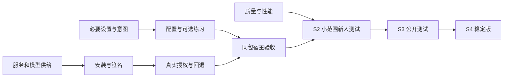

# UI、交互与发布核查表

核查日期：2026-09-15。当前为 S1 个人试用。表单填写完成不代表所有发布门槛通过。 当前事实持续更新于 [status](../status.md)，本表为本次核查快照。

后续进展：2026-09-16 已完成 C11 暂停语义说明及同包重启验证，见 [日常操作验收](../validation/2026-09-16-daily-flow.md)。下表及 Excel 保留 9月15日快照；当前版本与待验项以 status 为准。

当前运行：macOS 15.6 / arm64，0.2.0 / 2，提示契约 .16，安装 SHA256 `372409c800fbe9f7008d894396e0f2e17da787e28d6566de3fc1db55bf44dd28`。运行身份现场复核，不将旧包的物理按键验收当当前包验收。

表内“已完成”仅指该行限定范围；“部分完成”“未验证”“已知缺口”“待决策”“建议后置”均不计作发布通过。建议目标不是已锁定承诺。

## 核查总表

| 编号 | 项目 | 结论 | 已核查事实 | 剩余动作与完成条件 | 依赖与阶段 | 依据 |
| --- | --- | --- | --- | --- | --- | --- |
| C01 | 双开关首页 | 已完成 | 首页只保留本机补全、在线补全。正常状态无需滚动。 | 保持两项选择；不再实施五页常驻侧栏。 | S1；不依赖品牌或下载器 | [E01](#e01) [E06](#e06) [E13](#e13) |
| C02 | 规则与联网范围 | 已完成 | 当前范围有快捷入口；设置按明确应用或站点编辑，带规则版本检查。 | 既有保护边界保持；新宿主另列验收，不推断全部应用支持。 | S1；新增宿主依赖 C16 | [E01](#e01) [E02](#e02) |
| C03 | 配置草稿与保存 | 已完成 | 草稿跨页保留，失败可重试，放弃/关闭清理密钥字段，不回显旧密钥。 | 保持当前行为；不为验收覆盖真实密钥。 | S1；新用户实机见 C12 | [E02](#e02) [E04](#e04) [E06](#e06) |
| C04 | 新用户在线默认关闭 | 已完成 | 未保存偏好且未配置时在线默认关闭；既有明确选择与已配置旧用户保留。 | 首次开启经配置成功后启用，取消/失败保持关闭。 | S1；真实服务供给依赖 C20 | [E04](#e04) |
| C05 | 错误直达处理入口 | 已完成 | 身份验证失败从首页直达配置；超时进详情，不触发自动联网或改开关。 | 保持错误与动作对应；真实凭据失效场景纳入 C12。 | S1；异常闭环依赖 C12 | [E06](#e06) |
| C06 | 重新检查输入状态 | 已完成 | 恢复入口不再宣称服务已连接；实际监听恢复与返回首页已核对。 | 维护输入恢复与服务可用的区别；暂停时先回首页继续。 | S1；不等于 C21 运行验证 | [E06](#e06) |
| C07 | 历史导入许可与暂停 | 已完成 | 新用户未同意不启动历史导入；用户手动暂停不被全局继续覆盖。 | 保持意图迁移与零导入回归；导入内容完整性见 C18。 | S1；可选历史依赖 C18 | [E02](#e02) [E04](#e04) |
| C08 | 两步新手练习 | 已完成 | 固定合成示例练习 Tab/Esc，可跳过、重开、重练，不调用生成或历史。 | 作为可选帮助保留；不把练习通过当真实服务就绪。 | S1；真实上手依赖 C12 C13 | [E03](#e03) |
| C09 | 按用户生成模型配置 | 已完成 | 移除固定用户名；缺运行程序不写入；旧自定义配置保留。 | 工具已验收；普通用户安装包仍依赖 C21 C22。 | S2 子项；C21 C22 | [E07](#e07) |
| C10 | 模型文件只读预检 | 已完成 | 启动脚本、Python 和默认缓存分片有检查；26 项 Python 用例及模型保护回归通过。 | 仅文件层通过；继续模块加载、生成和新机器检查。 | S2 子项；C21 | [E08](#e08) |
| C11 | 全局暂停跨重启语义 | 部分完成 | 单次会话暂停/继续已实现；当前全局暂停为内存状态，源码未见持久化。 | 建议明确为本次运行暂停，或另行实现跨重启保留；重启行为须实测，不混同已持久化来源开关。 | S1 说明；S2 升级上手前锁定 | [E14](#e14) [E12](#e12) |
| C12 | 真实新用户授权与配置 | 未验证 | 已做隔离权限/配置回放；尚未在干净 macOS 用户实际拒绝、授权返回。 | 同一候选完成拒绝后零越界读取、授权返回、保存失败重试与首次真实候选。 | S2；C20/C21 C22 C25 | [E04](#e04) [E08](#e08) |
| C13 | TextEdit 显示与接受 | 部分完成 | 旧安装 7cd61149…：浮层显示、实体 Tab 插入44字及全文64字读回一致。 | 最终发布候选补实体 Tab/Esc；当前 372409c8… 的 UI 修改版未重测实体键。 | S1 回归；S2 同包证据 | [E05](#e05) [E06](#e06) [E15](#e15) |
| C14 | Esc 与原文保持 | 部分完成 | 旧安装记录实体 dismiss、overlay hide；原20字在 AX 与保存文件中一致。 | 最终候选补消失后的视觉核对；不把“好了”视为明确视觉结论。 | S1 回归；C13 | [E05](#e05) [E06](#e06) |
| C15 | WorkBuddy 当前会话 | 部分完成 | 5.5.6 的 A/B/A 前文数量3/1/3、C恢复3条；pending 时不以空上下文抢跑。 | 补最终候选正文逐条核对与实体插入；长对话500ms中断和整体耗时待测。 | 若首发承诺则阻断 S2；C16 C27 | [E09](#e09) |
| C16 | 声明支持的宿主矩阵 | 未验证 | 局部 TextEdit、WorkBuddy 证据不覆盖所有应用、浏览器或 WPS。 | 锁定系统/架构/应用版本与控件；逐项显示、接受、取消、切换、改规则及敏感输入验证。 | S2；C19 C24 | [E05](#e05) [E09](#e09) [E12](#e12) |
| C17 | 浮层完整显示与可访问性 | 部分完成 | 设置有明暗渲染和真实窗口检查；未完成长候选、边缘、多屏、IME与VoiceOver矩阵。 | 确保插入全文可审读，中文组合输入不被截断，不抢焦点；按声明设备补实测。 | S2；C16 C24 | [E01](#e01) [E03](#e03) [E05](#e05) [E12](#e12) |
| C18 | 历史导入失败与表达库 | 已知缺口 | 9月14日实机计数237处理，18失败，表达0且构建跳过；原因未查。 | 建议首发不承诺历史表达。若开放：定位失败类型、重试恢复、表达生成及管理验收。 | 可选；开放则为 S2 条件 | [E02](#e02) |
| C19 | 只续写与安全边界 | 部分完成 | 策略/身份/焦点/迟到回包与不自动发送有回归；语义仍存在未覆盖场景。 | 最终包执行声明输入边界与任务切换矩阵，零越界读取、串话、错插或自动发送。 | S1/S2 硬条件；C26 | [E02](#e02) [E09](#e09) [E10](#e10) |
| C20 | 在线服务与费用归属 | 待决策 | 在线端点固定；当前服务可用不代表外部试用者有使用权或凭据。 | 建议先明确小范围指定用户的服务、凭据发放和费用；公众方案另定。 | S2 前；影响 C12 C22 C29 | [E08](#e08) [E12](#e12) |
| C21 | 本机运行时与模型供给 | 已知缺口 | 现有虚拟环境依赖本机 Homebrew；缓存文件齐全不证明跨机器加载或完整性。 | 按目标机器准备运行时，固定依赖/模型版本及校验；明确下载许可、失败恢复、磁盘需求。 | 若首发提供本机来源则为 S2 条件 | [E07](#e07) [E08](#e08) |
| C22 | 普通用户安装与卸载 | 已知缺口 | 仍有开发命令和已有环境前提；守护服务依赖限定 guarded plist。 | 制作对应分发路径；新用户名/无开发工具可安装；卸载明确助手、模型和数据归属。 | S2；C20/C21 C25 | [E11](#e11) [E12](#e12) |
| C23 | 真实更新与失败回退 | 部分完成 | 已有备份、限定助手更新和有限事务回放；未完成通用服务适配和真实失败回退。 | 同一新旧包验证停止/复制/启动失败，最多一次恢复，运行身份、模型和偏好保持。 | S2；C22 C24 C25 | [E11](#e11) [E16](#e16) |
| C24 | 可追踪候选与支持范围 | 已知缺口 | 当前0.2.0/2、230411e dirty；本机macOS15.6 arm64，不证明14.0或Intel支持。 | 整理可审查源码基线并锁定候选及首发范围；提交/分发另按实际授权执行。 | S2；所有最终同包验收之前 | [E11](#e11) [E15](#e15) |
| C25 | 发行签名与权限迁移 | 未验证 | 当前 ad-hoc 验签通过，仅本机身份检查；未完成发行身份与干净环境安装。 | 按分发渠道准备签名、公证或组织部署；验证新装、升级和系统权限迁移。 | 跨机器 S2；公开 S3 必须 | [E11](#e11) [E12](#e12) [E15](#e15) |
| C26 | 生成质量 | 部分完成 | .16有合成评阅与回归；仅本机开放生成仍有原意偏移，远程有超时。 | 冻结开发/留出样本并审读拼接全文；作者角色、事实、否定与范围保持。失败来源缩小承诺。 | S2/S4；C20/C21 | [E10](#e10) |
| C27 | 整体性能与稳定性 | 未验证 | 局部耗时与成功样本存在；不足以证明整体验收P95及超时率。 | 记录所有成功、失败、取消和无候选分母；建议热场景P95≤3秒、超时≤5%，目标待冻结。 | S2；C16 C20/C21 | [E09](#e09) [E10](#e10) [E12](#e12) |
| C28 | 非开发者上手测试 | 未验证 | 尚无5名未参与开发者的完整上手结果。 | 建议至少5人完成首用/接受/取消/恢复，记录每步结果；4/5独立完成仅为筛查目标。 | S2；C12 C13 C22 C23 | [E12](#e12) |
| C29 | 名称、隐私与发布资料 | 待决策 | 工作名未定；当前版本、服务与历史行为已记录，尚非完整对外资料。 | 名称定稿后统一资源；按真实数据与网络行为完成说明、许可、已知问题及反馈入口。 | S3；C20 C21 C24 C25 | [E12](#e12) [E15](#e15) |
| C30 | RC观察及稳定发布 | 未验证 | 没有同一RC在声明环境连续5个工作日的完整观察结果。 | S3退出后观察同一候选，严重问题清零；核心变更后重验相关流程，不能仅等日期到期。 | S4；C16 C19 C23 C26 C27 C28 C29 | [E12](#e12) |
| C31 | 登录启动与自动更新 | 建议后置 | 没有足够证据支持新增有效的登录启动开关或通用自动更新。 | 首发先使用可验证的安装与手动更新；未来开关须读回真实状态，自动更新须依赖真实回退。 | 不阻断首发；C22 C23 后再做 | [E11](#e11) [E12](#e12) |

## 必要设置

| 编号 | 设置或动作 | 必要性与位置 | 类型 | 为什么需要 | 简化路径 | 依据 |
| --- | --- | --- | --- | --- | --- | --- |
| S01 | 本机补全 | 必要，首页 | 开关 | 用户决定是否使用本机来源；不会自动安装模型。 | 首页直接切换。保留既有选择，不增加模式或性能参数。 | [E01](#e01) [E07](#e07) [E08](#e08) |
| S02 | 在线补全 | 必要，首页 | 开关 | 用户明确决定联网。初次未配置默认关闭，配置成功不等于服务健康。 | 首次开启直接进入配置，成功后返回首页；取消和失败保持原意图。 | [E04](#e04) [E06](#e06) |
| S03 | 应用与站点范围 | 必要，次级 | 规则入口 | 控制哪些输入允许补全及联网；敏感/未知范围的保护不可取消。 | 菜单当前范围快捷操作；设置中编辑明确目标，不要求用户反复切前台。 | [E01](#e01) [E02](#e02) |
| S04 | 在线凭据与模型 | 使用在线时必要 | 一次性配置 | 已有配置无需重填。密钥不回显，不在首页常驻。 | 初次开启或身份验证错误直达；正常修改从高级与帮助进入。 | [E04](#e04) [E06](#e06) |
| S05 | 辅助功能权限 | 首次必要 | 系统授权动作 | 属于系统前提，应用不能用自己的开关代替授权。 | 仅缺失时首页给入口，返回后刷新状态；真实拒绝/返回仍待验收。 | [E04](#e04) [E13](#e13) |
| S06 | 暂停/继续提示 | 必要，菜单 | 临时动作 | 用户需要快速停止干扰，来源选择不应随之改变。 | 菜单一次操作；暂停时首页直接继续。跨重启语义仍需明确。 | [E01](#e01) [E02](#e02) [E14](#e14) |
| S07 | 历史导入与表达使用 | 可选，高级 | 独立意图 | 导入、扫描暂停、表达检索职责不同；当前输入补全不依赖全历史导入。 | 默认不上首页；未修复历史失败前不承诺首发可用，不自动开启。 | [E02](#e02) [E04](#e04) |
| S08 | Tab/Esc练习 | 可选，帮助 | 教学动作 | 学习两种核心操作即可，不需要教程偏好或强制向导。 | 高级与帮助打开，随时跳过、重新练习或返回。 | [E03](#e03) |
| S09 | 输入状态检查 | 必要，帮助 | 恢复动作 | 用于焦点或监听异常，不能替代凭据、网络、模型问题处理。 | 帮助中执行后回输入框试用，不报告未经确认的服务成功。 | [E06](#e06) |
| S10 | 主题与快捷键自定义 | 建议不增加 | 沿用系统与固定键 | 当前没有证据需要独立外观或快捷键配置。 | 跟随系统明暗；Tab接受、Esc忽略固定，减少学习与冲突。 | [E03](#e03) [E12](#e12) |
| S11 | 登录启动与自动更新 | 建议后置 | 未来管理能力 | 真实服务管理和更新回退未闭合前，不能增加无效开关。 | 先完成安装与手动恢复，再按明确需要开放。 | [E11](#e11) [E12](#e12) |

## 交互流程

| 编号 | 触发场景 | 最短操作路径 | 异常与保护 | 关联项目 | 验收现状 | 依据 |
| --- | --- | --- | --- | --- | --- | --- |
| F01 | 第一次打开 | 打开设置，确认用途；缺权限时按提示授权；选择可用来源，返回输入框。 | 权限未授予不能显示就绪；可跳过练习，历史始终可选。 | C04 C08 C12 C20/C21 C22 | 部分完成：页面与隔离回放通过，真实干净用户待验。 | [E03](#e03) [E04](#e04) [E08](#e08) |
| F02 | 第一次开启在线 | 首页在线开关，填写配置，保存成功后启用并返回首页。 | 取消/失败不启用；配置成功仍需真实请求验证。 | C03 C04 C12 C20 | 隔离动作闭环通过；真实新用户联网未验。 | [E04](#e04) |
| F03 | 普通输入与接受 | 在允许范围继续写，等灰字，审读内容，Tab接受。 | 插入前核对焦点/输入/身份；读回不一致不能报成功，不自动发送。 | C13 C16 C19 | TextEdit旧包实体通过；最终候选同包重验。 | [E05](#e05) |
| F04 | 不想要本次建议 | 灰字出现后按Esc，继续原文编辑。 | 取消待处理候选，隐藏浮层并保留原文。 | C14 C16 | 旧包事件/原文保持通过；独立视觉和最终包待验。 | [E05](#e05) |
| F05 | 切换窗口或任务 | 用户切换目标，旧候选撤销，新上下文就绪后再生成。 | pending不按空历史抢跑；过期回包不显示，旧候选不可插入新任务。 | C15 C16 C19 | WorkBuddy计数/中断证据及合成回放已有；完整物理矩阵待验。 | [E09](#e09) |
| F06 | 关闭当前范围 | 菜单关闭当前应用/站点，或设置中选择明确目标后保存。 | 规则版本冲突需重载；保护范围不可改，联网授权不随快捷操作扩张。 | C02 C16 | 策略与UI回归通过；声明宿主的最终矩阵待验。 | [E01](#e01) [E02](#e02) |
| F07 | 在线身份验证失败 | 首页检查在线配置，修改凭据，保存后返回输入框重试。 | 保留草稿；不自动发测试请求，不保证保存即连通。 | C03 C05 C12 | 直达配置隔离回归通过。 | [E06](#e06) |
| F08 | 超时或暂时没有候选 | 有服务错误时查看详情；正常无候选继续输入即可。 | 完整输入或保护场景不是服务故障；不反复弹窗或自动切来源。 | C05 C26 C27 | 错误入口已接入，整体超时率与质量仍待验。 | [E01](#e01) [E06](#e06) [E10](#e10) |
| F09 | 输入位置卡住 | 高级与帮助，重新检查输入状态，返回输入框试用。 | 全局暂停时先回首页继续；不会宣称服务已连接。 | C06 C11 | 实际窗口与监听恢复通过，开关保持。 | [E06](#e06) |
| F10 | 想暂停全部提示 | 菜单暂停；需要时从菜单或首页继续。 | 保留单项来源与用户主动扫描暂停；跨重启表现需明确。 | C07 C11 | 会话内意图保护通过，跨重启语义未锁定。 | [E02](#e02) [E14](#e14) |
| F11 | 选择使用历史 | 高级与帮助进入可选历史页，了解范围后允许导入。 | 不导入也能补全当前输入；失败需可解释，不强迫开启表达库。 | C07 C18 | 许可与意图保护通过，真实18项导入失败未解决。 | [E02](#e02) [E04](#e04) |
| F12 | 新机器缺模型 | 运行安装前检查，按缺失项准备目标机器运行环境与模型，再做真实运行验证。 | 不复制旧虚拟环境充当安装，不把文件齐全当生成成功。 | C09 C10 C21 C22 | 维护者工具通过；面向普通用户的安装供给待做。 | [E07](#e07) [E08](#e08) |
| F13 | 升级失败 | 预留已核对旧包，仅更新助手；失败按已验证流程恢复一次并核对身份。 | 不重启模型、不用当前build冒充旧包、不覆盖偏好或无限重试。 | C23 C24 C25 | 限定更新与离线事务已有，真实通用回退未验。 | [E11](#e11) [E16](#e16) |
| F14 | 退出与卸载 | 退出当前助手；卸载时明确移除助手服务，数据与模型另列归属。 | 不误删Codex原始历史或共享模型；退出是否被服务拉起需实测。 | C11 C22 C23 | 完整新用户退出/卸载流程未验。 | [E11](#e11) [E12](#e12) |

## 阶段发布

| 阶段 | 对象与交付 | 现状 | 界面与交互要求 | 发布条件 | 划分依据 | 依据 |
| --- | --- | --- | --- | --- | --- | --- |
| S0 | 方案与现状核查 | 表单已完成 | 必要设置、现有流程、证据层次及依赖已填写。 | 本表不代表所有功能验收完成；源码可追踪交付仍见C24。 | 先确认用户实际需要什么，避免为发布增加无用设置。 | [E01](#e01) [E12](#e12) [E15](#e15) |
| S1 | 个人体验Alpha | 当前阶段 | 双开关首页、明确范围、可选练习、错误入口与配置意图保护。 | 限定本机试用与已知限制；最终包实体回归、全局暂停语义仍保留待项。 | 先保护已有用户日常输入和配置，允许在已知环境验证局部功能。 | [E01](#e01) [E06](#e06) [E15](#e15) |
| S2 | 小范围新手Beta | 尚未放行 | 新人能自行配置、授权、试用和恢复；安装可复现，错误有可执行处理。 | C12-C17、C19-C28按首发范围汇合；历史/本机来源若开放，额外满足C18/C21。 | 从开发者本机扩大到他人环境，必须解决服务、安装、权限与支持成本。 | [E04](#e04) [E08](#e08) [E11](#e11) [E12](#e12) |
| S3 | 公开Beta/RC | 尚未放行 | 主导航与开关语义冻结，名称/帮助/隐私/支持范围与下载包一致。 | S2通过；C29完成；发行身份、服务权利、许可和最终包验证齐备。 | 公开可获得意味着不能依赖现场解释或内部服务的默认可用性。 | [E11](#e11) [E12](#e12) |
| S4 | 稳定版1.0 | 尚未放行 | 主要流程稳定；RC阶段以修复和验证为主。 | C30及声明范围全部关键门槛通过，严重读取/错插/串话/数据问题清零。 | 稳定声明取决于同一候选的可靠性与观察记录，不取决于界面数量或版本号。 | [E12](#e12) |

## 依赖关系

| 编号 | 前置项 | 后续项 | 关系 | 为什么依赖 | 范围处理 |
| --- | --- | --- | --- | --- | --- |
| D01 | 服务使用权与凭据 | 首次在线配置与闭测 | 硬依赖 | C20先确定，C12才能以真实用户凭据验收。 | 保留本机现有开关；不默认向外分发内部服务。 |
| D02 | 本机来源首发范围 | 运行时/权重安装 | 条件依赖 | 承诺本机开箱可用时，C21必须先完成。 | 建议先支持明确已有服务的限定环境；尚未改变产品承诺。 |
| D03 | 签名及安装身份 | 真实权限授权测试 | 硬依赖 | C22/C25固定后再做C12，避免换身份导致旧权限证据失效。 | 隔离权限回放不能替代真实系统授权。 |
| D04 | 来源意图与规则 | 设置和新手交互 | 硬依赖 | C02/C03/C04/C07先定义动作边界，界面才能正确反映功能。 | 不因页面简化合并联网同意或历史导入意图。 |
| D05 | 最终候选与宿主范围 | 物理按键/输入法矩阵 | 硬依赖 | C24锁定后执行C13-C17，不拼接不同版本证据冒充同包通过。 | 每个新增声明宿主单独补链路验收。 |
| D06 | 可审读候选与焦点 | 接受和取消 | 硬依赖 | 显示内容及身份必须可靠后才能放行插入；C17/C19不可由装饰优化替代。 | 不把投递事件当全文插入成功。 |
| D07 | 安装路径与旧包身份 | 真实升级回退 | 硬依赖 | C22/C24/C25先固定，再做C23的故障和一次恢复。 | 成功更新不能替代失败回退证据。 |
| D08 | 历史导入修复 | 历史表达首发承诺 | 条件依赖 | 开放该能力时C18必须完成；不开放时不阻断核心输入补全。 | 建议保持可选且不承诺可用，不能隐瞒已有失败。 |
| D09 | 质量与性能 | S2与稳定范围 | 硬依赖 | C26/C27与UI并行验证，最后同候选汇合。 | 不能把长候选、更多输出或更漂亮页面当质量提升。 |
| D10 | 正式名称 | 公开资料冻结 | S3硬依赖 | C29名称定稿后统一权限说明、截图、下载页。 | S1可保留工作名，不自动更换内部标识。 |
| D11 | 真实回退 | 自动更新 | 后置依赖 | C23完成后再评估C31；手动可信更新可先交付。 | 自动更新不是首发必须项，回退是。 |
| D12 | S2实际新人测试 | 公开与稳定发布 | 顺序依赖 | C28在安装和核心操作完成后执行，S3后再做C30。 | 可压缩人数安排，不能删去环境与关键失败证据。 |

## 执行顺序

1. 保持双开关与可选帮助的产品结构，明确全局暂停跨重启的用户含义。
2. 先固定首批用户、在线服务/模型供给、签名与安装路径，准备可追踪候选。
3. 完成实际新装、授权返回与失败回退，再以同一包执行声明宿主、质量和性能验收。
4. 小范围新人测试通过后再冻结公开资料；稳定版依据同一RC的观察结果放行。

## 依据索引

- **E01 简化设置**：[记录](/Users/hcm-b0263/Desktop/Codex智能提示助手/docs/validation/2026-09-14-simple-settings.md)

- **E02 原生设置与意图保护**：[记录](/Users/hcm-b0263/Desktop/Codex智能提示助手/docs/validation/2026-09-14-native-settings.md)

- **E03 两步新手练习**：[记录](/Users/hcm-b0263/Desktop/Codex智能提示助手/docs/validation/2026-09-14-onboarding-practice.md)

- **E04 首次在线配置**：[记录](/Users/hcm-b0263/Desktop/Codex智能提示助手/docs/validation/2026-09-14-first-use-flow.md)

- **E05 TextEdit 真实按键**：[记录](/Users/hcm-b0263/Desktop/Codex智能提示助手/docs/validation/2026-09-14-focus-verification.md)

- **E06 错误处理与恢复**：[记录](/Users/hcm-b0263/Desktop/Codex智能提示助手/docs/validation/2026-09-14-recovery-ui.md)

- **E07 按用户生成安装配置**：[记录](/Users/hcm-b0263/Desktop/Codex智能提示助手/docs/validation/2026-09-15-model-agent-paths.md)

- **E08 模型文件预检**：[记录](/Users/hcm-b0263/Desktop/Codex智能提示助手/docs/validation/2026-09-15-model-preflight.md)

- **E09 WorkBuddy 切换与中断**：[记录](/Users/hcm-b0263/Desktop/Codex智能提示助手/docs/validation/2026-09-14-workbuddy-live-acceptance.md)

- **E10 生成质量及双来源分工**：[记录](/Users/hcm-b0263/Desktop/Codex智能提示助手/docs/validation/2026-09-10-author-deepening.md)

- **E11 构建与部署边界**：[记录](/Users/hcm-b0263/Desktop/Codex智能提示助手/docs/release.md)

- **E12 初始规划及阶段依据**：[记录](/Users/hcm-b0263/Desktop/Codex智能提示助手/docs/plans/2026-09-14-ui-onboarding-release-plan.md)

- **E13 当前设置实现**：[记录](/Users/hcm-b0263/Desktop/Codex智能提示助手/Sources/CodexPromptAssistantPOC/SettingsWindowController.m)

- **E14 当前运行与设置动作**：[记录](/Users/hcm-b0263/Desktop/Codex智能提示助手/Sources/CodexPromptAssistantPOC/main.m)

- **E15 当前运行身份复核**：[记录](/Users/hcm-b0263/Desktop/Codex智能提示助手/docs/evaluation/results/ui-release-checklist-2026-09-15/runtime-snapshot.json)

- **E16 有限更新事务**：[记录](/Users/hcm-b0263/Desktop/Codex智能提示助手/Tools/Release/update_transaction.py)
